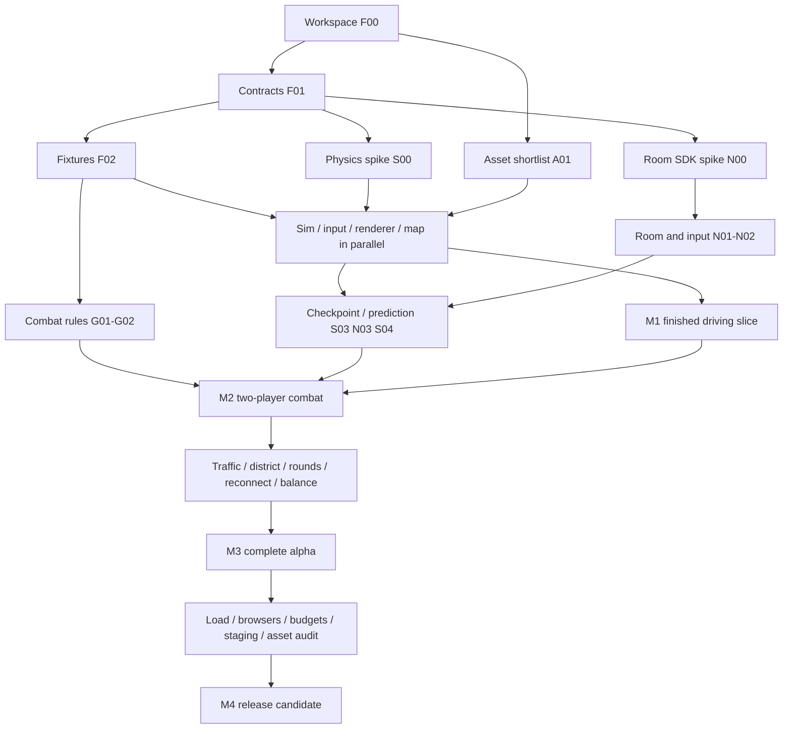

# Implementation plan

Status: implementation acceptance plan for the playable local alpha. Updated: 2026-10-22. Current states and observed evidence for all 49 tasks are in [the execution ledger](spec/EXECUTION_STATUS.md); this document retains the original gate definitions.

This plan delivers a polished browser arcade driving/combat game in five milestones. It is organized around eight logical lanes with explicit file ownership, shared contracts, fixtures, and integration gates. Lanes are responsibilities, not a requirement to run eight people or agents at once.

Read [PRODUCT_SPEC.md](spec/PRODUCT_SPEC.md), [ARCHITECTURE.md](spec/ARCHITECTURE.md), and [CONTRACTS.md](spec/CONTRACTS.md) before implementation. Acceptance definitions live in those documents; this plan owns work sequencing.

The progression epic adds a [ten-dispatch campaign](spec/CAMPAIGN.md). Its parallel lanes are campaign authority, authored story/portraits, briefing UI, and foundation/network integration. Freeze DTOs first, then allow the three feature lanes to work independently against the catalog and snapshot shapes. Integrate observed strict-TDD evidence before running real-client, browser, production-container and hosted checks. The campaign document records exact lifecycle rules, file ownership and acceptance; the original milestone gates below remain unchanged.

The [armed-target extension](spec/BOSS_COMBAT.md) uses three independent feature lanes after freezing grenade DTOs and tactics exports: simulation/attack rules, grenade presentation/audio, and callsign/briefing UI. Foundation owns compact snapshots, online/practice presentation clocks, real two-client/late-join tests, compatibility and publishing. Each lane must report its observed failing tests and passing handoff; foundation verifies the real adapters before deployment.

## 1. Execution rules

1. Establish contracts and a runnable workspace first. Keep M0 small: it unlocks parallel work and retires the largest physics/network risks.
2. Build vertical evidence early: a finished intersection in M1, two real players shooting each other in M2.
3. Separate pure logic from adapters. Use recorded frames, input scripts, mock sessions, and tiny maps to let lanes advance independently.
4. Assign an owner to each task and path before editing. Use separate branches/worktrees for concurrent contributors.
5. Integrate small changes continuously. Do not wait until the end of a milestone to merge an entire lane.
6. Gate completion on observed integrated behavior. A task branch passing its fixture checks does not establish multiplayer or release readiness.
7. Leave difficult optional features out until the core is stable. Ramming damage, WebGPU default selection, and advanced reflections are conditional improvements.

## 2. Lanes and exclusive file ownership

| Lane | Responsibility | Primary write ownership | Public handoff |
| --- | --- | --- | --- |
| F — Foundation/integration | Workspace, contracts, app wiring, decisions, integration | Root manifests/config/lockfile, `packages/contracts/**`, `apps/**`, `spec/CONTRACTS.md`, shared export surfaces | Versioned APIs, runnable composition, integration reports |
| S — Simulation/driving | Fixed-step physics, handling, prediction state, traffic | `packages/sim/src/core/**`, `vehicles/**`, `physics/**`, `traffic/**`; matching unit tests | Simulation factory, checkpoints, collision/map adapters |
| N — Networking | Room authority, transport, prediction, reconnect | `packages/net-client/**`, `packages/net-server/**`; network integration test helpers | Session facade, room factory, version/ack semantics |
| R — Rendering/audio | Babylon scene, camera, lighting, VFX, sound | `packages/renderer/**`; render scenario modules | Renderer adapter, render profiles, visual captures |
| A — Art/content | Source assets, provenance, maps, conversion | `packages/content/**`, `tools/assets/**`, approved source-art store | Validated map/catalog revisions, optimized assets |
| U — Input/UI | Keyboard/gamepad, menus, HUD, accessibility | `packages/input/**`, `packages/ui/**`; input/UI unit tests | Input source, UI facade, device/settings scenarios |
| G — Gameplay/combat | Weapons, damage, spawn, scoring, rounds, pursuit | `packages/sim/src/combat/**`, `rules/**`, `missions/**`; matching unit tests | Rule modules, game events, tuning proposals |
| Q — Quality/operations | Harnesses, CI, performance, deployment | `tests/**`, `infra/**`, CI workflow files, quality reports | Repeatable tests, network/load reports, staging runbook |

### Shared-file rules

- F owns root dependency additions and the lockfile. Other lanes submit exact dependency needs; do not independently regenerate the lockfile.
- F owns public barrel exports and simulation composition. S and G own separate internal directories; neither edits the other's rule files without coordination.
- F initially creates `packages/test-support/` and its fixture contract. Q owns the fixture harness thereafter; each lane owns scenario fixtures under its lane subdirectory. Cross-lane baseline fixture revisions go through F/Q.
- A owns runtime content and catalog revisions. R requests material/mesh adjustments through A rather than patching exported binaries locally.
- G proposes gameplay tuning; S reviews handling implications; F coordinates the versioned shared configuration update.
- Q owns CI workflows. F owns the root scripts they invoke. Agree command names before writing both sides.
- The owner of a source module owns colocated unit tests. Q owns cross-package integration/end-to-end tests. This avoids both duplicated tests and ownership ambiguity.

## 3. Milestones and gates

| Milestone | Demonstrable outcome | Required gate | Can already proceed in parallel |
| --- | --- | --- | --- |
| M0 — Contracts and feasibility | Workspace runs; headless sim and room/client spike work; all lanes have fixtures | F00–F03, S00, N00, A01, U01, Q01; dependency lock and risk decisions recorded | Asset sourcing, input prototype, renderer scene setup, test harness |
| M1 — Driving and visual slice | One finished intersection, one polished car, keyboard/gamepad, responsive camera/collisions | F04, R03, A03, Q02; actual in-engine visual/handling review | Combat logic, room protocol, HUD, district assembly |
| M2 — Two-player combat | Two real browser clients drive, shoot, damage, wreck, respawn, and recover from ordinary jitter | F05, S04, Q04; normal/stressed network evidence and no duplicate damage | Full map, traffic, round lifecycle, operations tooling |
| M3 — Complete alpha | 2–8 players, full district, traffic, three bodies, rounds/rematch, practice pursuit | F06 and its dependencies; full feature walkthrough | Device/browser matrix, long runs, final polish, staging |
| M4 — Release candidate | Measured performance, compatibility, asset audit, operational recovery | F07; P01–P10 evidence and release checklist | No new gameplay features; fixes/polish only |

M0 is a contract/feasibility gate, not a demand to finish every package. Downstream tasks may begin as soon as their explicit dependencies are available, even while other milestone tasks are in progress. Milestone gates still require integrated evidence.

## 4. Dependency structure



The task tables are the authoritative dependency graph. Diagram nodes group work for readability. The probable critical path is F00 → F01 → F02 → S01 → S02 → S03/N02 → N03/S04 → F05 → Q04 → F06 → Q05/Q08 → F07. Visual approval via A03/R03/Q02 is a second path that can become critical if deferred.

## 5. Task register

`S` means a small focused change; `M` means several focused changes or an integration experiment. These are relative sizes, not duration promises. Split any task that spans multiple unrelated APIs or cannot produce a reviewable handoff. Consult [the execution ledger](spec/EXECUTION_STATUS.md) for current implementation states and remaining evidence.

### F — Foundation and integration

| ID | Gate / size | Depends on | Deliverable and done criteria |
| --- | --- | --- | --- |
| F00 | M0 / M | none | Create pnpm workspace, strict TS configs, package boundaries, formatting/lint setup, env example, placeholder dev entrypoints, test/build scripts and CI command contract. Pin supported runtime/package-manager versions. Fresh clone installs from lockfile; `dev`, `check`, `test`, `build` have truthful behavior. Choose source-art storage and record reference hardware with Q. |
| F01 | M0 / M | F00 | Implement CONTRACTS.md types/validators, coordinate fixture, input/state/event versions and adapter APIs. Define all previously illustrative types concretely. Compile sample consumers from every lane; validation rejects bad ranges/shapes and incompatible versions. Freeze v1 for parallel work. |
| F02 | M0 / M | F01 | Publish tiny map, input replay, render frames, combat events, room lifecycle, asset catalog, fake clock/session and expected outcomes. Consumers can develop without a live server or finished art. Fixture revision and ownership are recorded. |
| F03 | M0 / S | F02 | Wire dev-only scenario discovery, client/server composition roots and lifecycle cleanup through adapters. Add skeleton practice/online mode selection and useful failures. Verify the app imports public package APIs only. |
| F04 | M1 / M | F03, S02, U02, R02, A02 | Integrate real practice simulation, input, map and renderer. Demonstrate driving/braking/reverse/collision/reset on keyboard and gamepad. Clean shutdown/remount leaves no duplicate loops or listeners. |
| F05 | M2 / M | F04, N03, G02, U03, U04, R04 | Integrate live online session and combat presentation. Two real browsers join and exchange damage/wreck/respawn. Practice remains usable. Confirm no mocks or client-owned health/score remain in online path. |
| F06 | M3 / M | F05, N05, S06, G04, G05, U05, R05, A04, Q02 | Assemble the complete alpha: eight-player mode, round/rematch, full district, traffic, pursuit practice, three visual car bodies, settings/reconnect. Walk through every product feature and record missing/failed items before marking complete. |
| F07 | M4 / S | F06, Q08 | Resolve remaining release-blocking findings, verify P01–P10 evidence, update README to actual commands/features and known limits. Produce release-candidate notes and a deployable build. Public launch remains a separate decision. |

### S — Simulation and driving

| ID | Gate / size | Depends on | Deliverable and done criteria |
| --- | --- | --- | --- |
| S00 | M0 / M | F01 | Prove pinned Rapier loads in browser and headless server; planar constraints, simple car contact, static collision, snapshot/restore, and identical input replay work. Measure a small scene and document limits. Decide initial physics/prediction restoration strategy with N00; use a bounded spike rather than a full vehicle framework. |
| S01 | M1 / M | F02, S00 | Build fixed-step core, monotonic tick, seeded RNG, map colliders, config loading, entity lifecycle, checkpoint format, and test clock. Rendering cadence does not alter outcomes; invalid geometry/config fails early. |
| S02 | M1 / M | S01 | Implement arcade acceleration, braking/reverse, steering, grip/drift, dirt transitions, bounded contacts and stuck recovery hooks. Slalom/corner fixtures pass; 30/60/144 fps rendering does not change simulated travel. Expose tuning without engine leakage. |
| S03 | M2 / M | S02 | Implement local authority restore/replay including controller/timer state and prediction-world rebuild/snapshot strategy. Replaying unacknowledged inputs does not duplicate effects or retain incompatible contact state. History exhaustion has explicit resync behavior. |
| S04 | M2 / M | S03, N02 | Integrate time-aligned remote collision proxies and quantify car-contact divergence. Add contact scenarios and correction traces. If the gate fails, simplify bounded contacts through the documented fallback; no unbounded smoothing workaround. |
| S05 | M3 / M | S02, F02 | Implement traffic lane following, intersection behavior, jam recovery, spawn limits and server ownership against the fixture lane graph. Demonstrate 8–16 vehicles without indefinite roadblocks; same rules run in practice and online. F06 verifies the finished district integration. |
| S06 | M3 / S | S04, S05, G03 | Profile combined driving/traffic/combat sim, remove unnecessary allocations and stabilize caps/cleanup. Deliver reproducible eight-player room-step measurements and state disposal test; do not claim many-room capacity yet. |

### N — Networking

| ID | Gate / size | Depends on | Deliverable and done criteria |
| --- | --- | --- | --- |
| N00 | M0 / M | F01 | Verify selected Colyseus client/server versions through one real room. Check schema publication, per-player acknowledgment, reconnect and available prediction helpers. Document helper-vs-custom adapter choice, APIs and version pins; coordinate with S00 without introducing task cycles. |
| N01 | M2 / M | F02, N00, S01 | Build authoritative room factory, admission, session identity, version checks, seeded sim startup, lifecycle and disposal. One headless client joins a real room and receives coherent state; no Babylon dependency enters server. |
| N02 | M2 / M | N01 | Implement validated input batches, per-tick consumption, bounded queue, stale-input neutralization, sequence acknowledgments, 20 Hz publication and server clock estimate. Use scripted/minimal driving to avoid waiting for handling polish. Reject spoofed state/damage, invalid numbers, duplicates and excess commands; backlog reset is observable. |
| N03 | M2 / M | N02, S03 | Implement session facade, local prediction controller, authoritative restore/replay, bounded visual correction and remote interpolation. Scripted input works through a real room; prediction ownership is singular; teleports/respawns reset history. |
| N04 | M3 / M | N03 | Add reconnect reservation/epochs, full resync, 2-second stall recovery, hidden-tab recovery, room expiry and typed failure states. Expired reconnect cannot resurrect a removed entity; stale commands/fire never replay after resync. |
| N05 | M3 / M | N04, G03, S05 | Run eight-client room scenario with traffic and full rounds. Late join, creator departure, results/rematch and slot expiry remain consistent. Report bandwidth and limits with Q; ensure join/content mismatches fail clearly. |

### R — Rendering and audio

| ID | Gate / size | Depends on | Deliverable and done criteria |
| --- | --- | --- | --- |
| R01 | M1 / M | F02 | Create Babylon renderer facade, right-handed scene, GLB loading, fixed-frame fixture viewer, resize/quality settings, WebGL2 path and resource disposal. Scene loads without network/simulation imports. Missing asset produces a useful failure. |
| R02 | M1 / M | R01 | Implement elevated camera, look-ahead, smoothing, visual car lean/wheels and collision-independent presentation using frame fixtures. Verify reverse/turn readability and no steering changes from camera movement. Camera consumes render frames, not raw input or network schemas; live control review occurs in F04/Q02. |
| R03 | M1 / M | R02, A03 | Finish intersection lighting/materials/shadows and car paint/glass/lightbar. Produce neutral and afternoon captures at gameplay distance, plus frame-time and transfer report. Agree the art direction before expanding district art. |
| R04 | M2 / M | R01 | Implement pooled shots/tracers/hits/wreck effects, skid/smoke feedback and audio adapter against published event fixtures. Repeated/confirmed events do not duplicate flashes/sounds; restore/replay is silent. Respect volume/reduced-flash/shake settings; F05 verifies live events. |
| R05 | M3 / M | R03, R04, A04 | Integrate full district, instancing/LODs, occlusion fade, bounded light/effect pools, low/medium presets and cleanup. Capture eight-player-equivalent action scene within provisional budgets and identify remaining cost drivers. |
| R06 | M4 / S | R05, Q05 | Evaluate WebGPU startup selection, parity, fallback and context-loss recovery. Enable only tested paths; WebGL2-only release is acceptable if WebGPU fails. Record the actual supported matrix, without claiming a newer API guarantees speed. |

### A — Art and content

| ID | Gate / size | Depends on | Deliverable and done criteria |
| --- | --- | --- | --- |
| A01 | M0 / S | F00 | Create candidate/provenance manifest and shortlist one main art family plus material sources. Check exact archive licenses; resolve or exclude uncertain sources. Record free vs paid content and select source storage policy with F. |
| A02 | M1 / M | F02, A01 | Author/export collision and visual intersection data with spawns, dirt zone and lane graph. Implement map/reference validation and collision overlay fixture. Shared map hash is identical for client/server. |
| A03 | M1 / M | A01, F01 | Finish one player car and intersection assets: scale, pivots, materials, textures, attachment points, collision shapes, compression and provenance. Export actual runtime assets; report sizes/material counts and remove placeholder status only after inspection. |
| A04 | M3 / M | A02, A03 | Expand to district loop/shortcuts and three visual vehicle bodies, with coherent palette and validated spawns/routes. Supply optimized low variants and licensed audio sources. All shipping files appear in the manifest; no hidden premium/source files enter client output. |

### U — Input and interface

| ID | Gate / size | Depends on | Deliverable and done criteria |
| --- | --- | --- | --- |
| U01 | M0 / S | F01 | Implement normalized keyboard/gamepad source, action edges, active-device detection, dead zones, safe disconnect/focus behavior and a dev input display. Test with actual standard-mapped hardware when available; flag untested devices. |
| U02 | M1 / M | U01, F02 | Add remapping/sensitivity persistence, keyboard steering ramp, controller menu navigation and hold-to-recover UI. Device changes preserve session; losing focus clears controls; unknown mappings produce clear fallback. |
| U03 | M2 / M | F02 | Build nickname/practice/create/join/loading/error UI against fake session lifecycle. All flows are keyboard/controller navigable. Room links and failure messages work once real adapter is supplied; nickname rendering is safe. |
| U04 | M2 / S | F02 | Build HUD, health/speed/ammo-policy indication, scores, timer, device prompts and connection status against frame/event fixtures. Health and score are read-only projections of confirmed state; avoid per-frame component-tree churn. |
| U05 | M3 / M | U02, U03, U04, N04 | Integrate live reconnect, results/rematch, online-menu neutralization, volume/reduced-effects settings and onboarding. Test hot unplug, tab switching and rejoin through complete user flows. |

### G — Gameplay and combat

| ID | Gate / size | Depends on | Deliverable and done criteria |
| --- | --- | --- | --- |
| G01 | M2 / M | F02, S01 | Implement forward projectile weapon, tick-based cadence, swept/relative-motion hit tests, wall blocking, owner immunity and semantic events against scripted vehicle bodies. No client-supplied hit/damage is trusted; duplicate processing cannot double damage. Polished handling is not a prerequisite. |
| G02 | M2 / M | G01 | Implement health, wreck/respawn, safe spawn selection, protection, kill credit and recovery eligibility using fixture spawns. Test simultaneous lethal hits, blocked spawns, protection ending on fire and no score for reset/self events. Validate the authored map when F05 integrates it. |
| G03 | M3 / M | G02, N01 | Implement lobby/countdown/playing/results state machine, server-owned round timer, creator reassignment, late join and rematch. Define deterministic simultaneous-event ordering. Tests cover equal scores and participant loss during transitions. |
| G04 | M3 / M | S05, G02 | Build local pursuit challenge: suspect behavior, intercept/arrest conditions, timer and completion feedback. Keep mission rules separate from multiplayer free-for-all; complete using keyboard or controller. |
| G05 | M3 / S | G03, G04, N05, Q04 | Playtest speed/visibility/weapon cadence/respawn fairness and tune shared configuration with traceable revisions. Decide optional ram damage only after contact stability evidence. Deliver a repeatable fun/playability checklist, not just numeric balance changes. |

### Q — Quality and operations

| ID | Gate / size | Depends on | Deliverable and done criteria |
| --- | --- | --- | --- |
| Q01 | M0 / M | F01 | Implement CI/harness foundation, contract/import/doc validation, report metadata and reference-device record. Agree root script interface with F. Fast checks run from a clean checkout and fail on real errors; no empty tests reported as coverage. |
| Q02 | M1 / S | F04, R03, A03, Q01 | Run keyboard/controller driving acceptance, actual-camera visual review, collision alignment and cold-load/frame measurements. Document exact device/settings and outstanding issues. M1 passes only on the integrated slice. |
| Q03 | M2 / M | F02, Q01, N00 | Build network impairment runner, multi-client test support, input/correction traces and authority adversarial cases. Distinguish TCP/network loss from synthetic application drops. Harness works against the N00 tiny real room before full game integration. |
| Q04 | M2 / M | F05, S04, Q03 | Execute two-player combat under LAN/normal/stressed profiles. Verify hit/wreck/respawn/score consistency and correction bounds; record human playability evidence and reject duplicate damage/replay effects. Extended stall/reconnect profiles follow N04 and are rechecked in Q05. |
| Q05 | M4 / M | F06, Q04 | Run eight-player/full-district load, full network profile matrix including interrupted/lost sessions, frame-time, bandwidth, cold-load and ten-rematch memory tests. Then measure multi-room density separately. Fix blockers with owners and repeat only affected scenarios; publish measured capacity. |
| Q06 | M4 / M | Q01, N04, F05 | Prepare container/health/readiness/TLS-proxy configuration and staging runbook. Validate startup, join, graceful drain, shutdown, version mismatch and rollback in staging when access is available. External credentials/hosting are explicit dependencies, never fabricated success. |
| Q07 | M4 / S | A04, R05, G05, U05 | Audit all shipping model/texture/audio licenses and runtime references; inspect input accessibility/settings, safe nickname rendering, and production debug exclusion. Link findings to responsible lane and verify fixes. |
| Q08 | M4 / M | Q05, Q06, Q07, R06 | Complete named browser/OS/controller matrix, release checklist and P01–P10 evidence index. State any unsupported combinations and external launch prerequisites. No release-candidate gate passes with unrun critical tests. |

## 6. Suggested parallel dispatch

### M0 start, up to four active contributors

| Worker | First assignment | Next independent assignment |
| --- | --- | --- |
| 1 | F00 → F01 | F02 → F03; own small integration/contract reviews |
| 2 | Prepare A01 source/license inventory, formalize after F00 | A03 → A02 as contracts/fixtures land |
| 3 | After F01: S00 | S01 → S02 |
| 4 | After F01: N00 | Q01 or U01, then hand off the other explicitly |

Before F01 lands, workers can inspect sources and prepare decisions but must not invent incompatible production interfaces. U01, Q01, and renderer setup can be reassigned to the next free worker. Do not keep one worker idle solely to preserve lane labels.

### After contracts/fixtures, highest-value parallel streams

| Stream | Work | Stub/fixture that prevents waiting |
| --- | --- | --- |
| Driving + input | S01/S02 and U01/U02 | Scripted input and collision map |
| Visual + content | R01/R02 and A02/A03 | Recorded render frames; placeholder catalog |
| Online + combat | N01/N02 and G01/G02 | Shared sim API, event fixtures, tiny room |
| UX + quality | U03/U04 and Q01/Q03 | Fake session lifecycle and prerecorded events |

With eight contributors, assign one per lane. With four, pair F/Q, S/G, N/U, and R/A initially, then rebalance around actual dependency readiness. A paired worker must serialize conflicting edits and may hand a ready task to another worker. The ownership map remains authoritative regardless of worker count.

### After the visual/driving slice

- Networking/prediction proceeds on simple test maps while art expands the district.
- Combat rules proceed headlessly while VFX/audio consumes fixture events.
- UI handles reconnect/error fixtures before live reconnect is finished.
- Operations packaging begins once the server entrypoint is stable, without waiting for art.
- Keep at least one contributor focused on integration/evidence at M2–M4, rather than allowing every worker to start another feature.

## 7. Integration protocol

1. Claim a task in the ledger with owner, branch/worktree, paths, and expected handoff.
2. Confirm dependencies are merged or agree an explicit provisional contract revision. Record provisional assumptions.
3. Implement only the task's scope. Publish any required fixture/contract change before downstream code relies on it.
4. Run meaningful lane checks and provide the handoff below.
5. Integration owner wires adapters through app roots and runs relevant cross-package checks.
6. Mark `done` only after acceptance evidence exists on the integration branch. Use `ready-for-integration` while awaiting wiring/review.

Suggested branch naming: `lane-s/s02-arcade-controller`, `lane-r/r03-visual-slice`. Worktrees are recommended for concurrent contributors, not created automatically by this documentation task. Avoid long-lived lane branches that accumulate several milestones.

### Required task handoff

```text
Task: N03
Owner / branch / commit:
Changed paths:
Public contract revision:
Behavior delivered:
Validation commands and results:
Scenario/report links:
Known limits / unresolved failures:
Integration steps:
Next unblocked task IDs:
```

### Task claim/status ledger

The active ledger is [spec/EXECUTION_STATUS.md](spec/EXECUTION_STATUS.md). F owns updates or assigns a single coordinator. Do not have every lane edit this plan to report progress. Its `Implemented`, `Partial`, and `Open` summaries separate principal code delivery from unpassed acceptance gates.

```text
Task | State | Owner | Branch/worktree | Contract revision | Evidence | Blocker
S02  | in-progress | ... | ... | v1 | ... | none
```

For future work claims, `todo`, `claimed`, `in-progress`, `ready-for-integration`, `done`, and `blocked` may track execution detail. The current ledger uses the broader summaries above. A blocker must identify its dependency, decision or access requirement. Do not mark a gate passed because remaining work was moved to an unnamed future task.

## 8. Task completion checklist

- [ ] Behavior and limits match the owning specification.
- [ ] Public interfaces match the agreed contracts; no private cross-package imports.
- [ ] Relevant unit/contract/integration checks pass with real evidence.
- [ ] Failure and cleanup behavior are implemented, including listener/resource disposal.
- [ ] No secrets, unlicensed assets, dev placeholders, or debug-only dependencies leak into production output.
- [ ] Required metrics/captures identify build, content/config versions, and environment.
- [ ] Documentation describes what now exists; provisional commands/assumptions are updated where applicable.
- [ ] Downstream owner can reproduce the handoff without relying on conversation history.

## 9. Risk register and response

| Risk | Earliest evidence | Response / owner |
| --- | --- | --- |
| Car contacts diverge under prediction | S00, S04, Q04 | Simplify bounded contact model, verify replay time alignment; S/N |
| Art looks inconsistent or generic | A03, R03, Q02 | Commit to one family/palette and improve focal cars before expanding content; A/R |
| Too much smoke/lighting harms readability or fps | R04/R05 | Cap pools/lights, reduce effects, compare actual gameplay captures; R/Q |
| Keyboard/controller feel unequal | U02, Q02, G05 | Tune response ramps/dead zones and weapon usability without changing authoritative stats by device; U/S/G |
| Task parallelism creates contract churn | F01/F02 reviews | Freeze small interfaces, publish compatibility adapters and fixtures before migrations; F |
| Library prediction API does not fit physics | N00 | Keep it behind the session/prediction adapter and use one validated implementation; N |
| Asset license or paid/free scope unclear | A01/Q07 | Verify archive evidence or replace with known permitted assets; A |
| Browser/device support overclaimed | Q01/Q08 | Record actual matrix and ship clear fallback/support limits; Q/R/U |
| Room density exceeds CPU/network budget | S06/Q05 | Reduce traffic/effects-independent sim cost, cap rooms, size hosting from measured load; S/N/Q |
| Hosting access unavailable | Q06 | Finish container/runbook/local staging proof; leave external staging gate explicitly open; Q/F |
| Working name has a conflict | Before public branding | Complete appropriate clearance or rename brand assets; project owner |

## 10. First actions for the implementing contributor

1. Read [AGENTS.md](AGENTS.md), the actual source, and [the execution ledger](spec/EXECUTION_STATUS.md).
2. Claim an unresolved task and its paths; confirm shared-file ownership.
3. Follow strict red–green–refactor for new behavior and fixes; report only observed test-first evidence.
4. Reuse published adapters and fixtures, with contract changes coordinated through F.
5. Prioritize human/controller/browser acceptance, contact-correction evidence and sustained performance/network measurements.
6. Validate staging and rollback before marking operations or release gates passed.

Do not start by building an account system, a full city editor, an economy, or an elaborate matchmaking service. The first evidence should be a car that feels good and a small scene that looks convincing.
