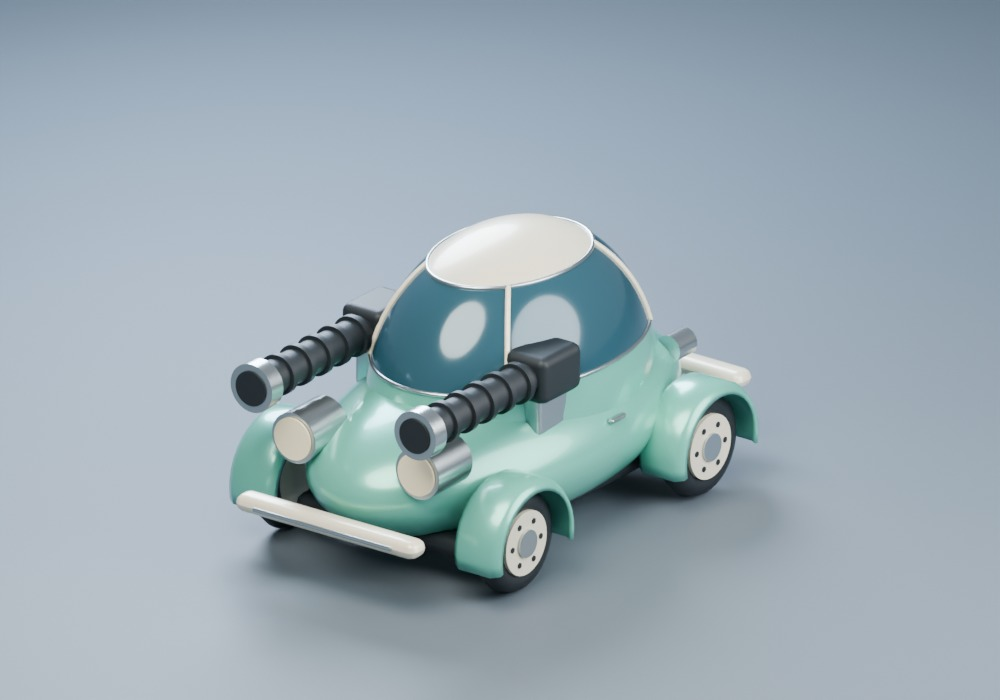
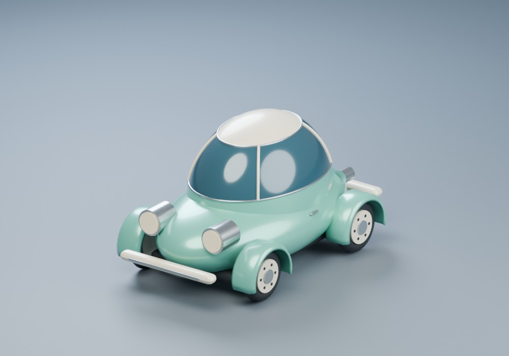
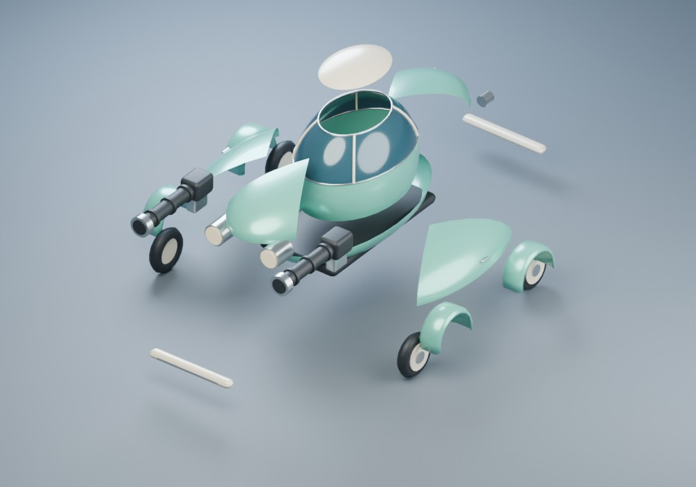

# Pocket Rocket: tiny bubble car

An original mint-and-cream microcar with an egg-shaped body, curved blue canopy, small wheels and optional oversized twin guns. Its procurement form says “compact”; the equipment department appears to have missed that line.

Original geometry, materials, scripts and previews are **GPL-3.0-or-later**, created with OpenAI Codex assistance under Stefan Andersson's direction. No downloaded vehicle mesh, texture, badge, blueprint or brand replica is included. See [provenance and license](../../packages/content/manifests/licenses/bubble/README.md).

`bubble-prepared.blend` is the editable detailed assembly. `tools/assets/bubble/prepare.py` is the canonical source recipe for the briefing, driving and distant GLBs. Direct Blender changes must be reflected in the recipe or saved as a versioned source change before regeneration. Keep the source scene outside runtime imports.

From the repository root, using Blender **5.2.2 LTS**, Node and the installed workspace dependencies:

```text
blender -b --disable-autoexec --python-exit-code 1 --python tools/assets/bubble/prepare.py
node --test tools/assets/bubble/validate.test.mjs tools/assets/bubble/export.test.mjs tools/assets/bubble/import.test.mjs
node tools/assets/bubble/validate.mjs
blender -b --disable-autoexec --python-exit-code 1 --python tools/assets/bubble/render.py
```

In PowerShell, put `&` before a quoted Blender executable path. Append `-- --quick` to the render command for one neutral briefing preview. The full render reimports the actual GLBs and creates eighteen JPEGs: neutral, rear, briefing/elevated noon/dusk/night, armed/unarmed, 28-degree front steering and exploded parts. [Capture settings](previews/capture.json) make the offline checks reproducible.

Visual acceptance: a small, rounded silhouette; mint/cream paint distinct from blue glazing and dark tyres; lamps seated in the body; continuous panel edges; small independently steerable wheels; clearly oversized twin guns that disappear completely when unarmed; and meaningful detachable canopy, roof and body panels. The distant LOD is for small screen coverage. Human appearance approval and actual game-camera/physics acceptance remain open.







The renderer must hide both gun nodes until normal equipment rules permit them. Guns do not enlarge the unarmed outer bounds or change gameplay collision. [Integration handoff](../../spec/handoffs/BUBBLE_ASSET.md) records exact axes, pivots, node names and validation evidence.
