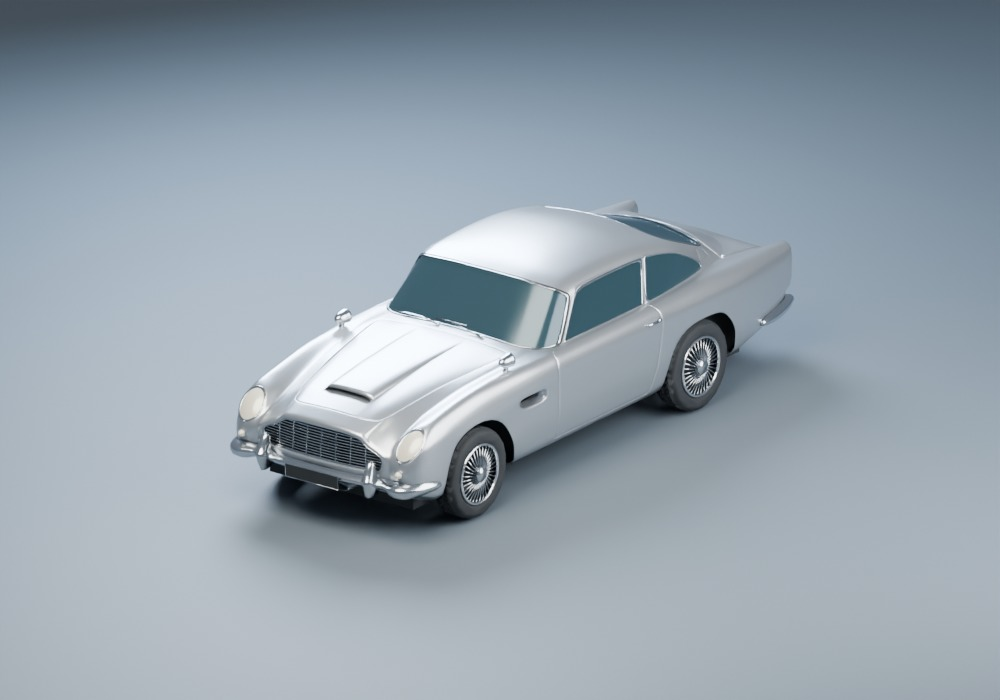
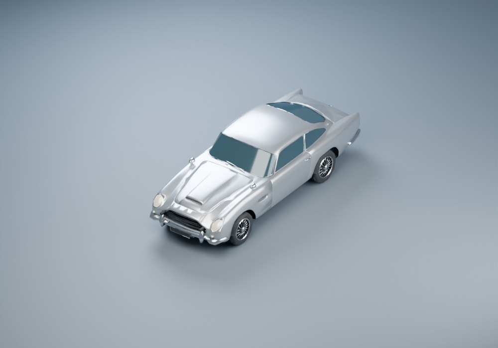
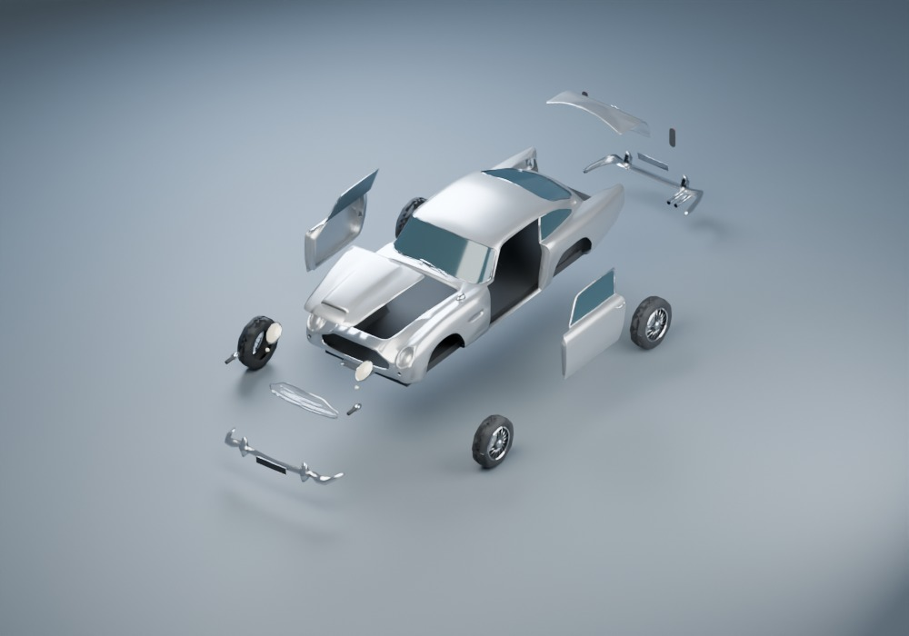

# DB5 Blender trial

**Third-party fan-art asset for the stated noncommercial hobby use.** Original artist: **natman**. The archive declares CC-BY 3.0 and explicitly prohibits commercial use. Read the [preserved original license and provenance](../../packages/content/manifests/licenses/db5/README.md). These models are not relabeled GPL. The garage paperwork travels with the car.

`natman-db5-original.zip` preserves the user-supplied detailed Blender source and its license. `db5-prepared.blend` is an editable exterior-only briefing assembly. The original archive retains the detailed engine, interior, materials and constrained opening panels; the runtime exports deliberately omit hidden detail. The prepared mesh has centered fragment pivots rather than source opening-panel animation. Keep both outside client imports.

From the repository root, with Blender **5.2.2 LTS**:

```text
blender -b --disable-autoexec --python-exit-code 1 --python tools/assets/db5/prepare.py
node --test tools/assets/db5/validate.test.mjs tools/assets/db5/export.test.mjs
node tools/assets/db5/validate.mjs
blender -b --disable-autoexec --python-exit-code 1 --python tools/assets/db5/render.py
```

On Windows, invoke the full Blender executable path with PowerShell `&`. The recipe verifies the ZIP hash, extracts only the expected `.blend` into ignored `work/db5/`, and opens it with `use_scripts=False`. It creates three GLBs under `packages/content/runtime/models/db5/` and records their component contract. Source edits must be reflected in the recipe or a clearly versioned source update to survive regeneration. Blender container bytes can vary on save; runtime repeatability is checked separately.

The original source uses Z-up and nose -Y. Export is meters, right-handed, Y-up and nose +Z. Wheels and optional guns keep the same axle/attachment origins in all LODs. The GLB includes both optional gun meshes: **the renderer must hide them on import until ordinary equipment rules permit them**. There is no portable default-visibility promise in the GLB.

The render script reimports the exported GLBs and renders close neutral/armed/rear views, briefing and elevated noon/dusk/night in armed/unarmed states, 28-degree steering and an exploded layout. These are offline Cycles previews with controlled lighting, not game camera or performance evidence. [Capture settings](previews/capture.json) and the script make them reproducible. [Integration handoff](../../spec/handoffs/DB5_ASSET.md) records exact node names, bounds, remaining acceptance and observed tests.







Visual acceptance: recognizable DB5 curves and grille, silver paint/chrome/rubber/glass separation, round tires, neatly recessed optional guns, aligned intact panels, coherent wheel steering and bounded meaningful debris. Reduced LODs must retain the large silhouette and wheel placement. Human appearance approval, actual game camera, importer/material support, physics and frame-time acceptance remain open.
