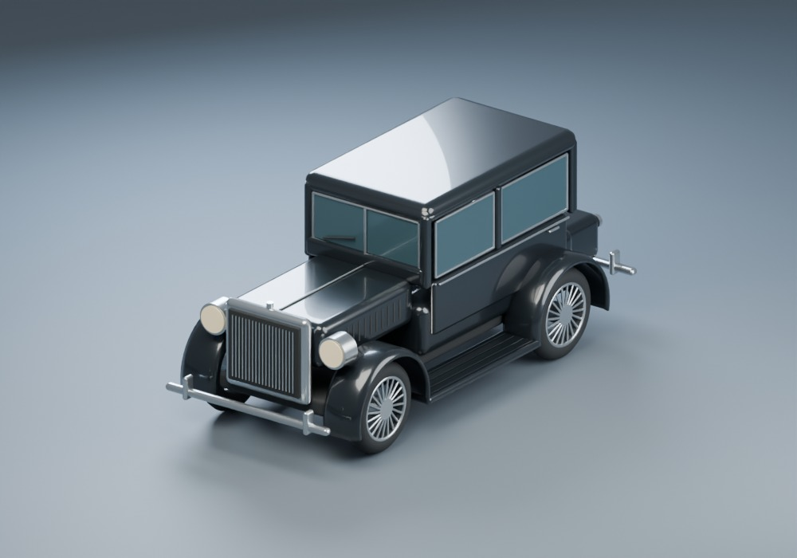
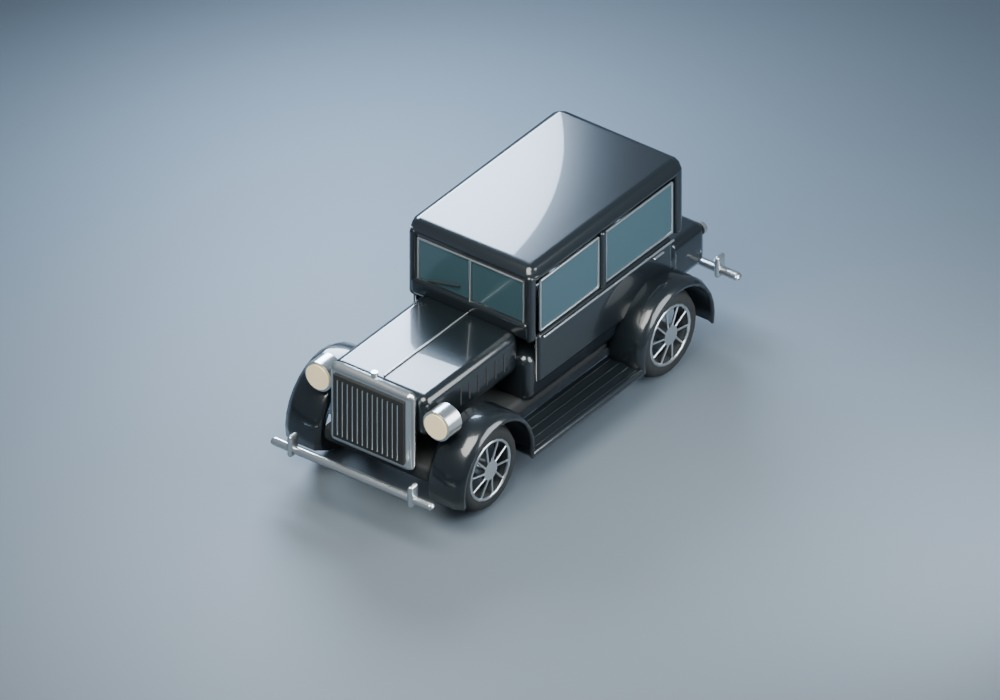
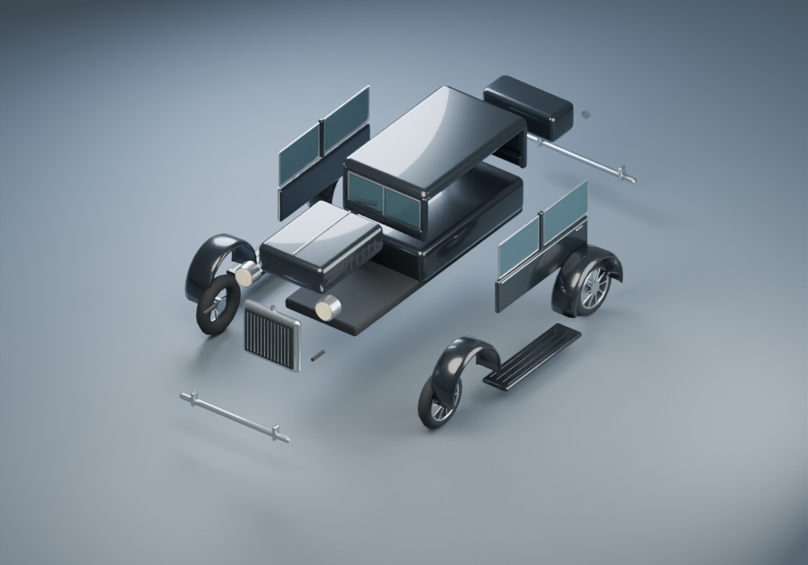

# Night Courier: original gangster sedan

An unbranded black 1920s-style enclosed sedan with a tall nickel grille, separate round headlamps, swept fenders, running boards and spoked wheels. Original Blender geometry for Fender Offenders, prepared with OpenAI Codex assistance under Stefan Andersson's direction. The motor pool denies all knowledge of the boot's contents.

The model, scripts and previews use the repository's **GPL-3.0-or-later** license. No downloaded vehicle mesh, texture, blueprint, badge or logo is included. [Provenance and source-selection record](../../packages/content/manifests/licenses/gangster/README.md) and the accompanying license travel with the delivery.

`gangster-prepared.blend` is the editable detailed assembly. Its 20 components are ordinary named meshes with PBR materials. `tools/assets/gangster/prepare.py` is the canonical source recipe for all three LODs. Direct Blender edits should be reflected in that recipe or recorded as a versioned source change before regeneration. The `.blend` is kept outside runtime imports.

From the repository root with Blender **5.2.2 LTS** and Node:

```text
blender -b --disable-autoexec --python-exit-code 1 --python tools/assets/gangster/prepare.py
node --test tools/assets/gangster/validate.test.mjs tools/assets/gangster/export.test.mjs
node tools/assets/gangster/validate.mjs
blender -b --disable-autoexec --python-exit-code 1 --python tools/assets/gangster/render.py
```

PowerShell requires `&` before a quoted executable path. Append `-- --quick` to the render command for a single briefing preview. Full rendering reimports the GLBs and produces eighteen neutral, rear, noon/dusk/night, armed/unarmed, steering and exploded JPEGs. [Capture settings](previews/capture.json) are recorded separately. These are offline visual checks, not game-renderer or frame-time measurements.

Visual acceptance criteria: recognizable enclosed 1920s silhouette, black paint distinguishable from rubber and blue-smoke glass, tall grille with round lamps, coherent broad fenders and running boards, wheels centered in arches, aligned detachable parts, subtle optional guns, and retained silhouette at each reduced LOD. The far LOD has deliberately coarse tyre and trim geometry; review it at small screen coverage. Human appearance approval and actual game-camera review remain pending.







The GLBs contain optional gun meshes and forward muzzle attachments. The renderer must hide guns on import until ordinary equipment rules allow them. [The integration handoff](../../spec/handoffs/GANGSTER_ASSET.md) describes axes, pivots, cosmetic collider suggestions and remaining acceptance.
