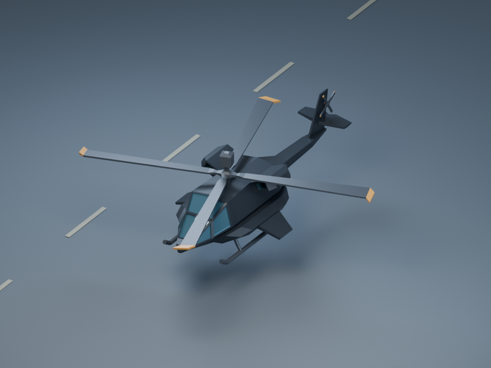
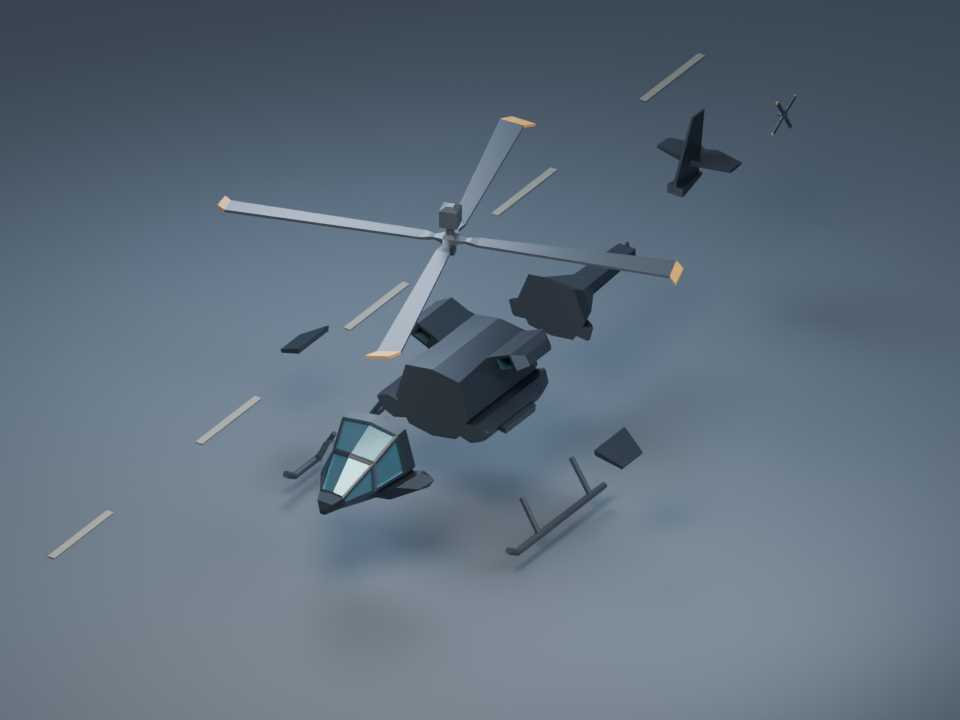
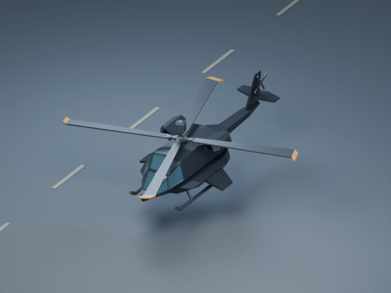

# Black helicopter trial

An artist-authored helicopter gets a charcoal paint job and a ten-piece incident report. This is an optional art trial, not a shipping replacement.

The pinned ZIP contains KumaSousa's original FBX and 32 x 1024 palette. `helicopter.blend` is the small editable prepared model. The source and previews stay outside the client build. [Provenance](../../packages/content/manifests/licenses/helicopter/README.md) identifies the original artist, license evidence and changes. [Handoff](../../spec/handoffs/HELICOPTER_ASSET.md) records integration ownership and acceptance limits.

From the repository root, using Blender **5.2.2 LTS** (on Windows, invoke its full executable path with PowerShell `&`):

```text
blender -b --python-exit-code 1 --python tools/assets/helicopter/prepare.py
node --test tools/assets/helicopter/validate.test.mjs tools/assets/helicopter/export.test.mjs
node tools/assets/helicopter/validate.mjs
blender -b --python-exit-code 1 --python tools/assets/helicopter/render.py
ffmpeg -hide_banner -loglevel error -y -framerate 12 -i asset-source/helicopter/previews/rotor-%02d.png -vf "split[s0][s1];[s0]palettegen[p];[s1][p]paletteuse" -loop 0 asset-source/helicopter/previews/rotors.gif
```

The authoring recipe reimports the pinned FBX, evaluates its first pose, retains the original airframe/rotor geometry, replaces palette mapping with four PBR materials, removes its four small wheels, adds skids, cuts/caps body sections, centers each piece and exports GLB. It rebuilds the two rotor clips with linear rotation. Edits to the `.blend` need equivalent recipe updates if they must survive rebuilding. Original source animation clips remain available in the ZIP; the runtime uses the two simpler spin clips.

The preview recipe **reimports the output GLB**. It renders the same elevated view at noon, dusk and night, then the exploded layout. The GIF shows a deliberately slow one-turn main rotor and two-turn tail rotor sequence for pivot inspection, not operational rotor speed or a motion-blur effect. `previews/capture.json` records camera, stage and lighting. Raw GIF frames are regenerated locally and ignored. The review stage is not an in-game capture.







Visual acceptance: coherent black/dark charcoal silhouette, legible blue-gray shaped glazing, visibly separate skids/tail/rotors, no displaced intact seams or floating fragments, and readable elevated noon/dusk/night previews. Human approval, gameplay camera, local physical breakup and performance remain open.

