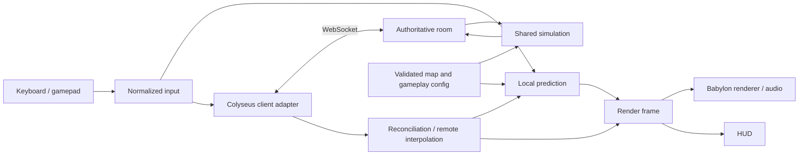

# Architecture

Status: architecture and acceptance targets for the implemented `arcade-v10` / protocol 2 alpha. Updated: 2026-10-25 for unified room sessions, following persistent street lighting. [Execution status](EXECUTION_STATUS.md) distinguishes delivered behavior from incomplete gates.

*One authority drives the rules. Everyone else gets a dashboard, not a spare steering wheel.*

The current code uses Babylon WebGL rendering, a custom Colyseus session/prediction facade, source-generated procedural art, and bounded planar vehicle contacts with Rapier WASM projectile/map queries. Sections describing a dynamic Rapier vehicle controller, GLB pipeline, WebGPU or complete operational recovery remain design targets unless the ledger explicitly records evidence. Public implementations are in `packages/`; app roots own composition. The full contact-correction, device/browser and hosting acceptance matrices are not complete.

## 1. System shape

The authoritative server has no renderer, DOM, or Babylon dependency. Every playable campaign runs in a server room. The browser runs a local menu-preview simulation and predicts its own car from room snapshots. Presentation consumes an immutable render frame rather than reaching into room schemas or physics objects.

## 2. Package dependency rules

| Package | Allowed runtime dependencies within workspace | Owns |
| --- | --- | --- |
| contracts | None | DTOs, validation, protocol/config versions, adapter interfaces |
| physics | None | Single initialization promise for the pinned Rapier WASM runtime; each adapter owns its own worlds |
| sim | contracts, physics | Vehicle controller, collision world, combat, traffic, game rules |
| input | contracts | Device sampling, mappings, dead zones, focus/disconnect behavior |
| renderer | contracts, content, physics | Babylon objects, materials, camera, audio, VFX, render interpolation and cosmetic debris physics |
| net-client | contracts, sim | Transport adapter, clock estimate, prediction history, reconciliation |
| net-server | contracts, sim | Room authority, input validation, state publication, reconnect |
| ui | contracts | DOM menus/HUD/settings, semantic UI actions |
| content | contracts | Validated runtime catalog, collision maps, asset/provenance records |
| test-support (planned) | contracts; sim only for replay helpers | Proposed central fixture catalog; current fixtures live with packages and under `tests/` |
| apps/client | Public APIs of client-facing packages | Composition, scheduling, lifecycle, error boundary |
| apps/server | net-server, content | Process startup, rooms, shutdown, health checks |

Only test/dev code may depend on `test-support`. Do not ship fixtures or debug overlays accidentally. No package imports another package's private source files. Enforce boundaries through workspace exports, lint/import rules, and a CI dependency check.

Third-party dependencies remain behind their owning adapter. Colyseus schema decorators belong to the networking packages, not domain DTOs. Babylon meshes/vectors and Rapier body handles never appear in shared contracts. UI components must not send raw transport messages or mutate simulation state.

## 3. Runtime ownership

| Concern | Authority | Client behavior |
| --- | --- | --- |
| Local input | Local device | Normalize, timestamp, sequence, queue |
| Vehicle movement and contact outcomes | Server in every playable room; local sim in previews/fixtures | Predict own motion; correct from snapshots |
| Opponents and traffic | Server | Interpolate; use collision proxies for local prediction |
| Health, hits, projectiles, score, timers | Server | Show provisional cosmetics, apply confirmed state |
| Camera, paint, smoke, skid marks, audio | Client | React to render frames and events |
| Map collision and gameplay config | Versioned content selected by server | Verify compatible content before joining |
| Menu/settings | Local UI | Send semantic requests through controller adapters |

Keep authoritative and rendered positions distinct. A correction changes simulation truth immediately; a separate visual offset can decay over a bounded interval. Never feed a smoothed visual pose back into physics.

## 4. Simulation

### Fixed-step scheduling

- One logical simulation tick is `1 / 60` second. Do not integrate with render frame delta.
- Server schedules from a monotonic clock, accumulates elapsed time, and steps fixed ticks.
- Server catch-up is capped at four fixed ticks per event-loop turn; larger backlogs trigger bounded clock/input recovery. Never replace the fixed delta with a larger one to catch up.
- Load-sensitive admission and sustained-overload health reporting remain operational acceptance work. Current room admission uses the configured room cap; `/ready` must not be read as proof that a five-minute load budget passed.
- Browser uses a fixed-step accumulator for predicted movement and independent rendering interpolation. Online, one frame runs at most four input ticks. Practice runs the authoritative simulation locally, so one frame may catch up a full quarter second (fifteen ticks) rather than let a slow or software-rendered machine play in slow motion; backlog beyond that is dropped (`apps/client/src/pacing.ts`).
- A hidden/suspended browser neutralizes input. On resume, request current state; discard stale prediction backlog instead of simulating every missed frame.

### Vehicle model

Vehicles use shared bounded planar geometry and impulses, with oriented rectangular footprints and two movement substeps. Rapier handles static projectile queries and the separate 3D scenery world. A headless Rapier feasibility fixture covers planar body locks, contact and restoration; dynamic Rapier vehicle bodies are not the shipped controller.

The bicycle tyre controller computes front/rear slip forces with speed-sensitive steering lock. Handbrake, power or a flick can break rear grip; a bounded drift servo gives stick-controlled angle and counter-steer recovery. Default patrol top speed/acceleration are 28/26; the six profiles scale shared tuning. Forward/reverse braking, drag and recovery remain shared rules. Never hardcode divergent handling in renderer and server.

The implemented planar controller reads the six shared vehicle profiles from `contracts`. Profile ratios scale configured speed, acceleration, steering and grip; maximum health scales the configured baseline. Authority, practice and local prediction use the same controller. Traffic retains baseline tuning. Weapons, collision dimensions, braking/reverse rules and spawn protection are equal across player profiles. Profiles were introduced in `arcade-v2`; `arcade-v3` adds the narrow aim-assist rule below. Mismatching clients must refresh. Measured trade-offs and the limits of the starting balance guard are recorded in [the balance report](../packages/sim/BALANCE.md).

The UI rolls a garage vehicle on the first visit and saves its ID in browser storage. Home and every campaign briefing offer a different random assignment, show profile stats and render a separate rotating garage scene. The join request carries only a validated body ID; the server derives all stats. Lobby reassignment is authoritative, broadcasts to observers, resets stationary driver state and locks at countdown. Respawn and reconnect preserve the selected profile.

Cartoon motion belongs entirely to presentation. The renderer keeps authoritative planar pose on the root, suspension bounce/pitch on a child and coachwork lean/squash on another child, leaving wheels and HUD markers outside body scaling. Shared decorative road-bump locations drive segment-crossing cues; damped lean and bounded compression/rebound never alter collision, prediction or health. Local squeaks/boings have cooldowns and respect effects volume/mute. Reduced motion or reduced shake suppresses deformation, its cues and garage rotation.

Collision solvers optionally report inward normal speed without changing their separation or impulse response. The simulation collects the strongest contact per car per tick and emits a confirmed `crash` for closing speed at least 3 m/s, capped at 60 m/s, with a 30-tick per-car cooldown retained in checkpoints. Crash events carry the car discontinuity so a delayed impact cannot deform a respawn. No velocity-drop heuristic, crash damage or client-claimed contact is involved.

Avoid assuming a rigid-body snapshot alone captures the whole game: include gameplay timers, controller state, IDs, RNG state, projectiles, and collision ordering where relevant. Use a seeded RNG for authoritative randomness. Pin Rapier versions and build options across client/server, but still reconcile; surrounding floating-point code and differing predicted participants can diverge.

### Predicting contacts

The client predicts its own car against static geometry and time-aligned kinematic proxies of nearby remote cars. The server applies shared bounded two-car separation/impulses. The predictor's kinematic response can disagree with that two-body outcome; measured collision-correction acceptance remains open.

The M0/M2 experiment must quantify the disagreement, restoring the local body's pose/velocities and controller state at the acknowledged point, then replaying remaining commands. Proxies must be restored/interpolated to the matching replay time, not copied from the newest render frame. Do not use a partial body restore that preserves incompatible stale solver/contact state: either rebuild the small prediction world or use a validated full snapshot/restore strategy.

The bounded planar fallback is already selected; it does not waive the playability gate. Improve replay/proxy time alignment and collect correction traces before tuning smoothing. Full-world rollback of all traffic and effects is outside scope.

## 5. Networking

### Transport and protocol

Colyseus provides room lifecycle and WebSocket transport. The pinned adapter publishes compact domain snapshots; it does not run a parallel equivalent schema stream. A custom session/prediction facade owns reconciliation. Installed versions are recorded in the root manifest/lockfile; domain interfaces remain independent of SDK APIs.

Baseline: 60 Hz sim, 30 Hz batches of up to two newly generated input commands, 20 Hz authoritative state publication. Batching and schema delta transport are implementation details; each semantic snapshot still needs a server tick and local input acknowledgment. Do not send a second full snapshot stream alongside an equivalent schema stream.

WebSocket is reliable/ordered. Packet-loss testing must model its stalls and retransmission behavior; dropping arbitrary application messages is only an additional robustness test, not a faithful TCP loss model.

### Input validation and processing

- Client sends inputs, never desired position, damage, health, or score.
- Server authenticates session membership, validates finite bounded fields, and enforces message size/rate limits.
- Sequence numbers increase within a session epoch. Duplicate/old commands are ignored.
- Each car consumes at most one command per simulation tick. Client sequence/tick values do not authorize additional elapsed simulation time.
- Queue a small bounded input window; never fast-forward a player because its client submitted hundreds of commands.
- Use a short hold of the last valid analog state to bridge normal jitter. After 100 ms without valid input, neutralize steering/throttle/fire; brake toward a safe stop. Safety/focus messages neutralize immediately.
- If backlog exceeds the validated maximum, discard stale commands, advance the acknowledgment boundary for discarded commands, and rebase the client from authoritative state. Record this as a queue reset, not successful command execution.
- Limit fire through simulation tick cooldowns. A command may request fire but cannot create arbitrary shots.

### Prediction and reconciliation

1. On each client simulation tick, generate an input command and apply it to the local prediction world.
2. Save command and prediction history in a bounded ring buffer; batch commands for transport.
3. On an authoritative update, locate the matching acknowledgment boundary and restore authoritative local-car state.
4. Discard commands at or below that boundary and replay eligible unacknowledged commands in order.
5. Decay small visual corrections over roughly 50–100 ms. Snap large/invalid corrections and respawns; clear relevant histories.
6. If history is insufficient or protocol/map versions change, perform a full resync instead of guessing.

Only one module owns prediction. If the chosen Colyseus release supplies suitable helpers, wrap those helpers inside `net-client`; otherwise implement the loop there. Rendering must not run an additional reconciler.

### Remote interpolation

Render other cars initially about 100 ms behind estimated server time, with a tunable 50–150 ms buffer. Interpolate buffered snapshots by server tick. Bound extrapolation to 100 ms, then hold/fade with a connection indication. Reset histories across teleports, respawns, and session epochs. Remote health and scores use confirmed state, not extrapolation.

The current implementation uses a fixed 100 ms buffer. Its presentation tick cannot move backward when a late snapshot lowers the clock estimate: playback holds until the estimate catches up. Match changes also clear history and the presentation tick. This prevents clock-induced backward motion; it does not remove authoritative collision corrections or implement an adaptive jitter buffer.

### Shared latency display

The server probes each connected player approximately once per second with an opaque, single-use nonce. The client echoes it; the server measures round-trip time with its monotonic clock and publishes `pingMs` in every observer's score rows. Keep an unanswered probe until its reply or five-second expiry so RTT above one second remains measurable. Accept replies only from the current connection with the current nonce. Measurements older than three seconds, disconnected players and unmeasured players publish `null`; reconnect clears the previous measurement. This is client-to-server RTT, not direct latency between players.

### Combat timing

Use visible projectiles and swept collision at server tick rate. Test a relative-motion sweep for moving targets, and treat teleport/respawn as discontinuities. This reduces tunneling and makes the first weapon understandable without hitscan rewind.

At firing, the authority considers active unprotected opponents or the explicitly identified suspect in either mode within a 4° cone, 2.5 m lateral distance from the original ray and 40 m total range. Each barrel spawns at its physical tip and independently selects a correction, sorted by angle, distance and stable entity ID. Rapier segment queries reject world occlusion; shared car-box segments reject nearer vehicles, including protected cars and civilians. A center-to-muzzle sweep prevents point-blank obstruction bypass. Each round deals 5 damage; the paired volley retains 10 total damage at 12-tick cadence. Cars are not steered and projectiles do not home or lead targets.

Static projectile hits emit `projectile-impact` at the swept contact point for wall sparks. Existing shot/hit/wreck events drive the bounded presentation effects and original Web Audio synthesis; presentation never changes health or projectile collision.

Do not rewind the whole world to a client-supplied timestamp in the initial build. Forward projectiles still require latency playtests; being server authoritative does not automatically make aiming feel fair. Consider a separate lag-compensation design only if those playtests justify it.

### Disconnect/reconnect

Reserve a slot for 10 seconds after unexpected disconnect. Neutralize and brake the car; keep it damageable and retain score. On reconnect, require the room's reconnect token/session epoch and send current full state. Clear old commands and visual predictions. On timeout remove the participant. Rejoining later creates a new session with no restoration guarantee.

Clients must receive a readable reason for full room, incompatible version, expired room, transport failure, or shutdown. Empty rooms freeze immediately and expire after 15 wall-clock minutes; admission can reclaim the oldest eligible empty room sooner. Reconnect and pending admission reservations are protected. Connected inactivity warns at 14 minutes and disconnects intentionally at 15. [Room sessions](ROOM_SESSIONS.md) specifies the state machine.

The online HUD keeps a visible Wi-Fi icon and text for connecting, connected, reconnecting and connection lost. Practice uses a local-dispatch label. Intentionally leaving disables SDK reconnect; disposal must also prevent an already queued retry from opening another socket and must finish when a close handshake never arrives.

### Reusable invites and admission

A URL-safe invite code of 8–64 characters uses `POST /dispatch/:invite`; the shared `isInviteCode` validator covers legacy and current ID lengths. The server joins the current room, or creates a new room with that exact code using the public Colyseus room-ID setter during creation. A per-code promise serializes simultaneous lazy creation, then each visitor gets an independent seat reservation. If the room disappears between lookup and reservation, the server retries at most three times. If a reservation expires or its room disappears before the browser's WebSocket join, the client obtains a fresh reservation for the same invite, also with a three-attempt bound. HTTP error JSON preserves the Colyseus protocol code; full/locked, authentication and capacity failures are not treated as missing rooms. After a restart the same link opens a new match; no saved gameplay state is implied. Invalid code formats do not allocate rooms.

Room admission reserves capacity before asynchronous physics initialization and releases it on failed creation or disposal. An initialization that outlives SDK disposal cannot resume into a live room. The health endpoint publishes aggregate occupancy, with connected players separate from reconnect reservations. A full server reports a distinct capacity error; joining an existing room remains possible.

Colyseus protocol error codes remain in response JSON, but its 520–526 codes are translated to standard HTTP statuses to avoid collisions with Cloudflare errors. Origin checks apply before reusable-invite allocation.

## 6. Maps and content

Split world data into a shared collision/navigation map and a client presentation scene. Both derive from the same source layout and share a map revision/hash. Visible curbs/walls must line up with collision; export and validate this relationship.

Server loads colliders, spawns, lane graph, gameplay zones, shared rigid-prop definitions and needed tuning. Client loads visual models/materials, sound, and the same collision map. Instance repeated meshes/materials where useful. Use stable asset IDs rather than source filenames in gameplay rules.

The separate authority Rapier scenery world uses gravity and full rotations, with car proxies pushing props and releasing anchored lamps/signs/trees. It does not feed forces into planar driving. Trusted checkpoints retain native state; replication sends an initial baseline and then meaningful changes. Presentation merges patches and interpolates them on the buffered clock.

Wreck debris uses another, client-only Rapier world. Car construction retains each original component alongside intact material batches; every fragment gets its own bounded rigid body and local ground/building/fragment contacts. No debris transforms, damage or impulses enter authority. `@fender/physics` owns a single WASM initialization promise shared by both adapters so starting or disposing one world cannot reinitialize another's runtime. Cosmetic pedestrians remain outside both physics worlds. [World reactions](WORLD_REACTIONS.md) records lifecycle, limits and safety.

The server advertises protocol, map, and gameplay config versions at join. A mismatching client loads the matching immutable content or fails with an actionable message. Silent collision-map mismatch is a release blocker.

## 7. Composition and parallel development

The integration lane owns app entrypoints. Other lanes expose factories behind contracts:

- Input: `createInputSource()`.
- Simulation: `createSimulation()`.
- Rendering: `createGameRenderer()`.
- Networking: `createGameSession()` / server room factory.
- UI: `mountGameUi()`.

The app uses `createOnlineSession()` for every playable room, including a single officer. A local `Simulation` remains solely for the menu preview/development. Shared snapshots/events/render frames feed the UI and renderer. Recorded frames, scripted inputs and tiny maps support isolated adapter work; a future common wrapper must preserve the real lifecycle coverage.

App composition also maps the current shared campaign index to its existing dispatch ID and calls `renderer.setDispatch`. `DispatchEnvironment` owns cosmetic noon/dusk/night fog and key/fill; it never changes gameplay state or transport. Every upright authority-owned lamp contributes to a cached 512×512 world-space diffuse-light field shared by Standard/PBR surfaces. All quality presets keep all lamps illuminated at dusk/night; there is no camera-distance selection or extra shadow light. Only lamp changes rebuild the texture. The garage keeps its separate studio scene. [Graphics polish](GRAPHICS_POLISH.md) sequences water, restrained flares and surface refinement after this atmosphere foundation.

Dev scenarios currently have explicit entrypoints under package `dev/` and `scenarios/` directories. A unified picker remains a foundation/fixture target. Keep these pages out of the production bundle and avoid requiring every lane to edit the same app file.

Production app/server roots explicitly enable campaign pursuit. Authority owns ten-stage outcomes, target tactics, bullet/grenade damage and phase transitions; static catalogs supply story and inline portraits. Practice and online freeze gameplay presentation outside live campaign play. Grenade warnings use exact practice ticks or a monotonic online authority clock; projectiles use local prediction or buffered remote clocks. See [campaign](CAMPAIGN.md), [boss combat](BOSS_COMBAT.md) and [contracts](CONTRACTS.md).

## 8. Deployment and persistence

Start with one persistent server process hosting several isolated rooms, with room state in memory. A process restart ends active rooms; the client must explain and recover to the room entry screen. Retained empty rooms are paused for up to 15 minutes, with capacity eviction; URLs recreate fresh campaigns after state is lost. No database is required for first release.

Serve versioned assets through a CDN. Route secure WebSocket traffic to a geographically suitable game server with TLS. A short-lived request function is not the room host. Add persistence, distributed matchmaking, Redis, or horizontal room placement only after measured capacity requires them.

Keep room admission configuration, allowed origins, timeouts, and build identity explicit. Never put server secrets into Vite public environment variables. Full operational guidance lives in QUALITY_AND_OPERATIONS.md.

## 9. Sources and implementation references

- [Babylon engine capabilities](https://www.babylonjs.com/specifications/).
- [Babylon WebGPU support](https://doc.babylonjs.com/setup/support/webGPU/).
- [Rapier JavaScript setup](https://rapier.rs/docs/user_guides/javascript/getting_started_js/).
- [Rapier determinism conditions](https://rapier.rs/docs/user_guides/javascript/determinism/).
- [Colyseus documentation](https://docs.colyseus.io/).
- [Colyseus prediction/reconciliation](https://docs.colyseus.io/netcode/client-prediction).

These references are background, not a dependency lock or a fresh compatibility audit. Use the pinned manifest, source and real-adapter tests for the current implementation. The architecture has enough moving parts without letting the documentation invent another reconciler.
